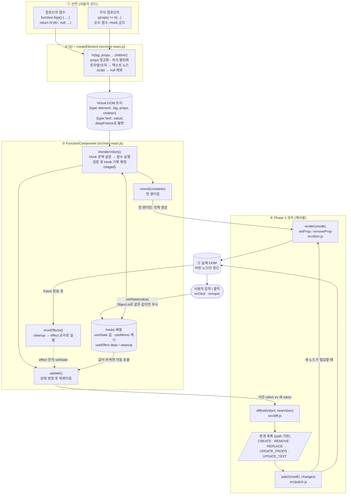
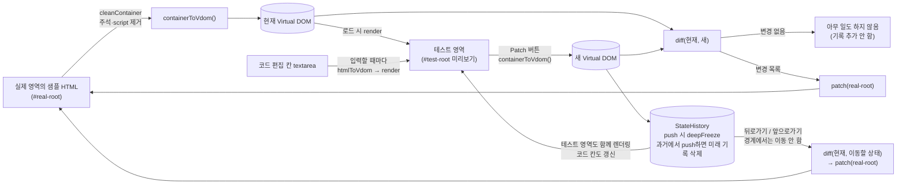

# Mini React 아키텍처: 데이터 흐름

> 이 구현에는 JSX 변환기가 없다. JSX 자리에는 `h(tag, props, ...children)` 호출을 직접 쓴다.
> `h()`가 React의 `createElement`에 해당한다.

## 1. 전체 흐름 (Phase 2: 컴포넌트가 화면을 갱신하기까지)

### 읽는 법
1. **선언 → ②**: 컴포넌트가 `h()`를 호출해 Virtual DOM 트리를 만든다. 자식 컴포넌트는 `h()` 안에서 즉시 호출된다.
2. **③ 렌더링**: 루트 `FunctionComponent`만 Hook과 상태(`hooks` 배열)를 가진다. 렌더링 중 변경은 임시 기록으로 모아 두었다가 성공한 뒤에만 확정한다.
3. **④ Diff → Patch**: 이전 Virtual DOM과 새 Virtual DOM을 비교해 변경 목록을 만들고, 목록의 노드만 실제 DOM에 반영한다.
4. **⑤ 실제 DOM**: 변경 없는 노드는 그대로 유지된다(포커스, 입력 중인 값 보존).
5. **되돌아오는 루프**: 사용자 이벤트 → `setState` → `update()` → 다시 ③.

## 2. Phase 1 검증 페이지의 흐름 (index.html)

같은 Diff·Patch·render 모듈을 쓰되, 입력은 `h()`가 아니라 **HTML**이다.

## 3. 모듈 의존 관계

| 모듈 | 역할 | 의존 |
| --- | --- | --- |
| `src/vdom.js` | DOM → Virtual DOM, `cleanContainer`, `deepFreeze`, `childContainer` | 없음 |
| `src/dom.js` | Virtual DOM → 실제 DOM(`render`), `setProp`/`removeProp`, 차단 속성 | `vdom.js` |
| `src/diff.js` | 두 Virtual DOM 비교 → 변경 목록 | `vdom.js` |
| `src/patch.js` | 변경 목록 → 실제 DOM 반영 | `dom.js`, `diff.js`, `vdom.js` |
| `src/history.js` | State History | `vdom.js` |
| `src/mini-react.js` | `h()`, `FunctionComponent`, Hooks | `vdom.js`, `dom.js`, `diff.js`, `patch.js` |
| `src/main.js` | Phase 1 검증 페이지 연결 | 위 모듈 전부(`mini-react.js` 제외) |
