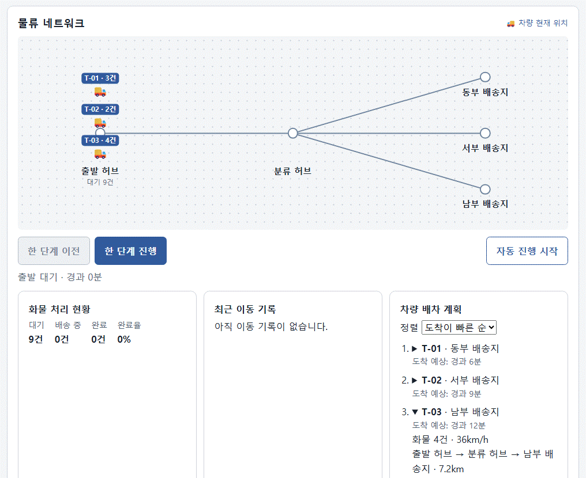
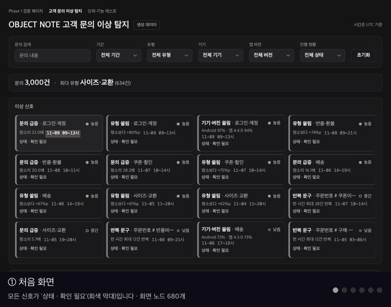
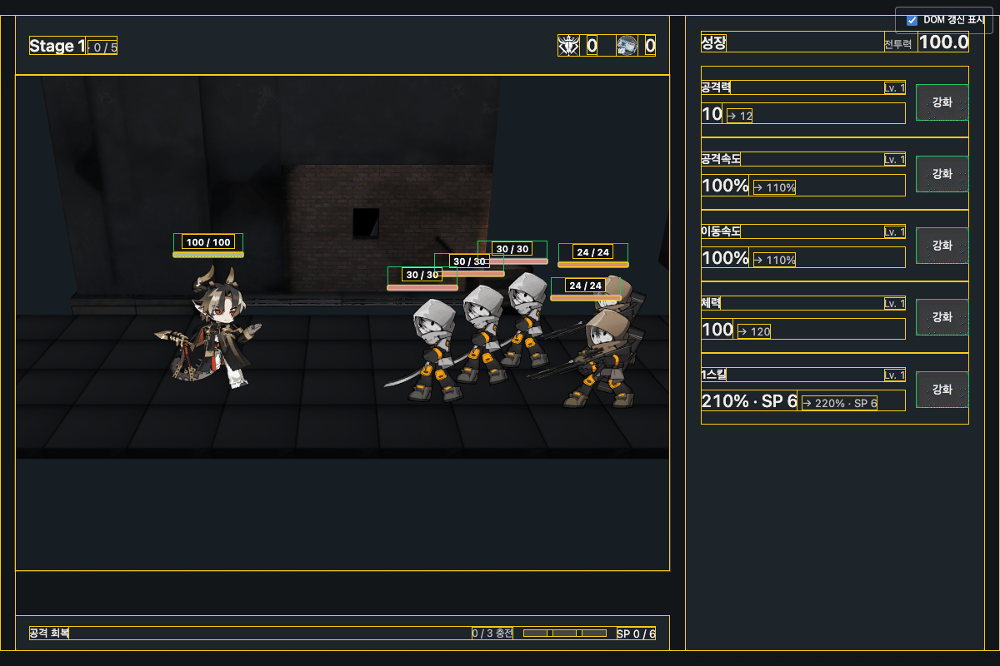

# Mini React | 상태 변경을 실제 DOM에 반영하는 엔진

Vanilla JavaScript로 함수형 컴포넌트, Hooks, Virtual DOM을 구현한 팀 프로젝트입니다. 상태가 바뀌면 컴포넌트가 다음 화면을 계산하고, Mini React가 이전 화면과 비교해 필요한 변경을 실제 DOM에 적용합니다. 두 실습과 물류 허브 시뮬레이터에서 같은 엔진이 화면을 갱신하는 과정을 확인할 수 있습니다.

## React 방식이 개발을 편하게 만드는 이유

웹 화면이 복잡해지면 하나의 상태가 여러 화면에 영향을 주고, 그 상태를 바꾸는 경로도 늘어납니다. 예를 들어 검색 조건은 입력란, 결과 목록, 결과 건수에 함께 반영됩니다. 입력창에서 조건을 바꾸든 초기화 버튼을 누르든, 개발자는 세 화면이 같은 조건을 보여주도록 갱신을 연결해야 합니다.

React 방식에서는 컴포넌트가 현재 상태에서 어떤 UI를 보여줄지 정의합니다. 이벤트는 상태를 갱신하고, 컴포넌트는 그 상태로 다음 화면을 계산합니다. 같은 상태를 보여주는 UI를 추가할 때는 해당 컴포넌트가 그 값을 어떻게 표시할지만 정의하면 기존 이벤트 처리 코드를 그대로 사용할 수 있습니다.

Mini React는 이 구조에서 상태를 보관하고 컴포넌트를 다시 실행하는 일을 맡습니다. 이전과 다음 화면을 Virtual DOM 트리로 비교해 생성·수정·삭제·이동할 DOM을 결정하고, 유지할 수 있는 기존 노드는 재사용합니다.

## Mini React 엔진의 갱신 흐름

```text
사용자 조작 또는 타이머
  → 상태 갱신
  → 컴포넌트 실행 및 새 Virtual DOM 생성
  → Diff로 변경 명령 계산
  → Patch로 실제 DOM에 적용
```

컴포넌트는 현재 상태에서 어떤 화면을 보여줄지 정의합니다. `diff`는 이전 Virtual DOM과 새 Virtual DOM을 비교해 변경 명령을 만들고, `patch`는 그 명령을 실제 DOM에 적용합니다. 예를 들어 `<p>배송 중</p>`가 `<p>배송 완료</p>`로 바뀌면, 기존 `p` 요소를 유지하고 자식 텍스트만 갱신합니다.

### Diff와 Patch

| 비교 결과 | 변경 명령 |
| --- | --- |
| 이전 트리에만 노드가 있음 | `REMOVE` |
| 새 트리에만 노드가 있음 | `CREATE` |
| 같은 위치에서 노드 타입이 달라짐 | `REPLACE` |
| 같은 타입의 노드에서 속성이 달라짐 | `UPDATE_PROPS` |
| 텍스트 노드의 내용이 달라짐 | `UPDATE_TEXT` |
| `key`가 같은 목록 항목의 위치가 달라짐 | `MOVE` |

같은 타입의 요소는 자식도 재귀적으로 비교합니다. 목록에 `key`를 지정하면 순서가 바뀌어도 같은 항목을 식별할 수 있습니다.

### 컴포넌트와 Hooks

각 앱의 루트 컴포넌트가 상태를 관리하고, 자식 컴포넌트는 필요한 값과 콜백을 props로 받습니다.

- `useState`는 렌더링 사이에 상태를 보관하고, 값이 바뀌면 화면 갱신을 요청합니다.
- `useEffect`는 DOM 반영 후 문서 제목 갱신이나 타이머 설정·정리 같은 작업을 수행합니다.
- `useMemo`는 두 번째 인자인 배열에 담긴 값을 이전 렌더링과 비교해, 모두 같으면 이전 계산 결과를 재사용하고 하나라도 달라지면 다시 계산합니다.

## 코드 구조와 테스트

### 코드 구조

| 역할 | 주요 파일 |
| --- | --- |
| DOM과 Virtual DOM 변환·렌더링 | `src/engine/vdom.js`, `src/engine/render.js` |
| 변경 계산과 적용 | `src/engine/diff.js`, `src/engine/patch.js` |
| 함수형 컴포넌트와 Hooks | `src/engine/component.js` |
| 실습과 상태 이력 | `src/labs/main.js`, `src/labs/history.js`, `src/labs/todos.js`, `src/labs/patch-summary.js` |
| 물류 시뮬레이터 | `src/logistics/logistics.js` |

### 엔진 테스트

| 검증 범위 | 개수 | 주요 검증 내용 |
| --- | ---: | --- |
| Virtual DOM 변환 | 6 | DOM 구조와 자식 순서를 유지하고, 공백만 있는 텍스트도 보존합니다. |
| 렌더링 | 4 | Virtual DOM에서 요소와 텍스트를 만들고, 함수형 이벤트 속성을 DOM 핸들러에 연결합니다. |
| Diff | 8 | 두 트리에서 생성·삭제·교체·속성·텍스트 변경 명령을 계산하고, `key`가 있는 목록의 변경을 처리합니다. |
| Patch | 9 | 변경 명령을 적용한 결과가 목표 트리와 일치하는지 확인합니다. 재정렬과 내용 변경이 겹칠 때 기존 DOM 객체가 재사용되는지도 검증합니다. |
| 컴포넌트와 Hooks | 17 | 상태 변경이 Diff·Patch를 시작하는지, 같은 값이면 렌더링을 생략하는지, effect 실행·정리 순서와 메모 재사용이 맞는지 확인합니다. |
| **합계** | **44** | **Mini React 엔진을 직접 검증하는 테스트** |

전체 저장소의 자동 테스트는 아래 명령으로 실행합니다.

```powershell
node --run test
```

### 대표 회귀 사례 · 목록 재정렬 중 내용 변경

`[A, B, C, D]`를 `[D, B, C, A]`로 재정렬하면서 B의 내용도 바꾸는 경우입니다. B는 비교 전후 인덱스가 같지만, D를 맨 앞으로 옮긴 직후에는 다른 위치에 있습니다. 처음과 끝의 인덱스만 보고 B의 이동을 생략하면, 내용 변경 명령이 엉뚱한 노드에 적용될 수 있습니다. Diff는 앞서 계산한 이동을 순서에 반영하고, B를 목표 위치에 맞춘 뒤 그 경로에 내용 변경을 기록합니다.

[회귀 테스트](tests/patch.test.js)는 Diff가 만든 명령을 적용한 뒤 최종 트리의 **순서와 내용**이 목표 트리와 일치하는지 확인합니다. 각 위치의 DOM 객체를 패치 전에 저장한 참조와 비교해 **기존 노드를 실제로 재사용했는지**도 검증합니다.

## 로컬에서 확인하기

Node.js가 설치된 환경에서 프로젝트 폴더의 개발 서버를 시작합니다.

```powershell
node --run dev
```

브라우저에서 `http://127.0.0.1:3000/`을 열면 실습 1과 2를 확인할 수 있습니다. 페이지의 **물류 시뮬레이터 열기** 링크로 시뮬레이터에 이동할 수 있습니다. 각 페이지는 브라우저에서 Mini React 엔진을 JavaScript 모듈로 불러옵니다.

## 두 실습에서 엔진 동작 확인하기

- **실습 1 · Virtual DOM, Diff, Patch** — 테스트 HTML 예제를 선택하거나 직접 수정한 뒤 **Patch 적용**을 누르면, 이전·다음 Virtual DOM과 변경 명령을 확인할 수 있습니다. **속성 삭제** 예제에서는 버튼의 `disabled`가 풀리고, `before === after`가 `true`로 표시되어 같은 DOM 객체가 유지됐음을 확인할 수 있습니다.
- **실습 2 · Component, State, Hooks** — **진행 중** 필터에서 할 일을 하나 완료하면, 루트 상태가 바뀌고 컴포넌트가 새 Virtual DOM을 만들어 목록과 요약을 함께 갱신합니다. **이번 실행**에서 상태 전후 값, Hook 실행 여부, 실제 Patch 명령을 확인할 수 있습니다.

실습 1은 **입력한 HTML**에서, 실습 2는 **변경된 상태**에서 다음 Virtual DOM을 얻습니다. 이후 두 실습 모두 같은 Diff·Patch 엔진을 사용합니다.

## 팀 활용 사례

### 물류 허브 시뮬레이터



한 단계 진행하거나 타이머가 동작하면 차량 상태가 바뀝니다. Mini React의 Diff·Patch가 지도 위 차량 위치, 배송 현황, 이동 기록의 변경을 화면에 반영합니다.

배차 목록을 정렬할 때는 차량 ID를 `key`로 사용해 `MOVE` 패치로 기존 DOM 행을 옮깁니다. T-03의 상세를 펼친 상태에서 정렬해도 기존 행과 그 안의 `<details>` 객체가 재사용되어 펼침 상태가 유지됩니다. GIF는 화면 결과를 보여주며, 물류 통합 테스트는 정렬 전후에 같은 DOM 객체가 유지되는지 확인합니다.

### 고객 문의 이상 탐지



필터를 바꾸거나 신호를 선택하고, 진행 현황에서 상태를 바꾸면 화면 상태가 바뀝니다. Mini React의 Diff·Patch가 신호 카드의 상태 색, 상세 영역, 상태 변경 이력의 변경을 화면에 반영합니다.

### Canvas 시뮬레이션과 상태 UI



엔진은 일정 주기로 Canvas를 갱신합니다. `useEffect`에서 등록한 콜백이 시뮬레이션의 변화를 받아 상태를 갱신하고, 버튼 조작도 `useState`의 setter를 통해 상태를 바꿉니다. Mini React는 그 결과를 체력바의 수치와 UI 요소의 위치에 반영합니다.

## 실제 React와의 차이

Mini React는 앱마다 하나의 루트 컴포넌트에서 Hooks를 관리합니다. 상태값이 같으면 렌더링을 생략하고, 값이 달라지면 즉시 갱신합니다. `useEffect` 실행 중 요청한 갱신은 현재 effect 처리가 끝난 뒤 수행합니다. 실제 React는 여러 상태 업데이트를 한 번의 렌더링으로 묶을 수 있습니다. JSX, Fiber, 우선순위 렌더링은 이번 구현 범위 밖입니다.
