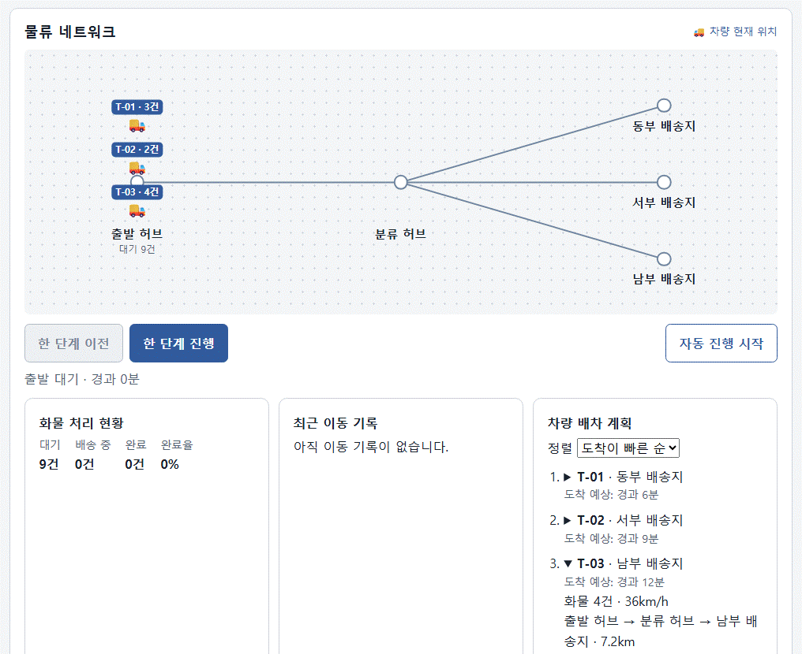

# Mini React 실습 · 물류 허브 시뮬레이터

Vanilla JavaScript로 구현한 **Mini React**입니다. 함수형 컴포넌트와 Hooks로 상태를 관리하고, Virtual DOM을 비교해 바뀐 부분만 실제 DOM에 적용합니다. 두 실습에서 엔진의 동작을 확인하고, 물류 허브 시뮬레이터에서 같은 엔진으로 차량 위치·배송 현황·배차 목록을 갱신합니다.

## 실행 방법

Node.js가 설치된 환경에서 프로젝트 폴더를 열고 개발 서버를 실행합니다.

```powershell
node --run dev
```

[Mini React 실습](http://127.0.0.1:3000/)을 열고 **물류 시뮬레이터 열기**를 누르거나, [시뮬레이터](http://127.0.0.1:3000/logistics.html)로 바로 이동합니다. 서버를 끄려면 터미널에서 `Ctrl+C`를 누릅니다.

## 엔진 동작 원리

```text
사용자 조작 → 루트 상태 변경 → 함수형 컴포넌트 재실행
→ Virtual DOM 생성 및 비교 → 필요한 변경만 실제 DOM에 적용
```

과제 Phase 2의 컴포넌트가 상태 변경 후 새 Virtual DOM을 만들면, Phase 1에서 구현한 Diff·Patch가 이전 트리와 비교해 실제 DOM에 변경을 반영합니다. 실습 1에서는 편집한 테스트 DOM을 Virtual DOM으로 변환하고, **Patch 적용**을 눌러 같은 엔진을 직접 검증할 수 있습니다.

### Diff 알고리즘과 Patch

Diff는 이전 트리와 새 트리를 같은 위치부터 재귀적으로 비교합니다. `key`가 있는 목록에서는 순서가 바뀌어도 `key`가 같은 항목을 찾아 변경을 계산합니다. Patch는 그 결과를 받아 실제 DOM에 적용합니다.

| 비교 결과 | Patch | 실제 DOM 처리 |
| --- | --- | --- |
| 이전 노드만 존재 | `REMOVE` | 기존 노드 삭제 |
| 새 노드만 존재 | `CREATE` | 새 노드 생성 |
| 노드 타입이 다름 | `REPLACE` | 노드와 하위 트리 교체 |
| 같은 타입, 속성이 다름 | `UPDATE_PROPS` | 기존 노드를 유지하고 속성만 변경 |
| 같은 텍스트 노드, 내용이 다름 | `UPDATE_TEXT` | 텍스트만 변경 |
| 같은 타입의 자식 | 재귀 비교 | 기존 노드를 재사용하며 하위 변경 탐색 |
| `key`가 있는 목록의 순서 변경 | `MOVE` | 같은 항목을 식별해 이동 |

### State와 Hooks

State와 Hook은 각 앱의 루트 컴포넌트가 관리합니다. 자식 컴포넌트는 부모가 넘긴 값과 콜백을 props로 받아 사용합니다. 할 일 앱에서는 입력폼·필터·목록·요약이 루트 상태를 공유합니다.

- `useState`는 할 일 목록이나 차량 위치 같은 상태를 유지하고, setter가 호출되면 화면 갱신을 시작합니다.
- `useEffect`는 할 일 개수를 문서 제목에 반영하거나 시뮬레이터 타이머를 관리합니다. 자동 진행을 정지하면 타이머를 정리합니다.
- `useMemo`는 할 일 필터 결과나 배송 현황을 계산합니다. 차량 상태가 그대로인 시작·정지 조작에서는 기존 배송 현황 계산 결과를 재사용합니다.

## 코드 구조와 테스트

| 역할 | 주요 파일 |
| --- | --- |
| DOM과 Virtual DOM 변환 | `src/vdom.js`, `src/render.js` |
| 변경 계산과 적용 | `src/diff.js`, `src/patch.js` |
| 함수형 컴포넌트와 Hooks | `src/component.js` |
| 실습과 상태 이력 | `src/main.js`, `src/history.js`, `src/todos.js`, `src/patch-summary.js` |
| 물류 화면과 이동 계산 | `logistics.html`, `src/logistics.js` |
| 개발 서버 | `scripts/dev-server.js` |

```powershell
node --run test
```

| 테스트 파일 | 주요 검증 내용 |
| --- | --- |
| [vdom.test.js](tests/vdom.test.js) | 실제 DOM을 Virtual DOM으로 변환하며 공백 텍스트를 보존하는지 확인합니다. |
| [render.test.js](tests/render.test.js) | Virtual DOM에서 실제 요소와 텍스트를 만들고 속성과 이벤트 핸들러를 연결합니다. |
| [diff.test.js](tests/diff.test.js) | 트리의 변경을 찾고, `key` 목록에서 불필요한 이동 명령을 생략하는지 확인합니다. |
| [patch.test.js](tests/patch.test.js) | 변경 명령을 적용하고, 재정렬과 내용 수정이 겹쳐도 올바른 DOM 노드를 갱신하는지 확인합니다. |
| [component.test.js](tests/component.test.js) | 컴포넌트와 Hooks의 동작, 같은 값의 렌더링 생략, effect 이후 갱신, 물류 화면의 진행·복원을 검증합니다. |
| [history.test.js](tests/history.test.js) | 스냅샷 저장과 이전·다음 이동, 과거 상태에서 새 변경을 추가할 때 이후 이력이 정리되는지 확인합니다. |
| [patch-summary.test.js](tests/patch-summary.test.js) | 렌더링 여부와 실제 Patch 결과를 설명 문구에 반영하는지 확인합니다. |
| [todos.test.js](tests/todos.test.js) | 할 일 필터링과 완료 상태 전환, 문서 제목 갱신과 복원을 확인합니다. |
| [dev-server.test.js](tests/dev-server.test.js) | 실습 안내와 물류 페이지의 이동 링크·렌더링 모듈이 제공되고, 미등록 경로가 404를 반환하는지 확인합니다. |
| [readme.test.js](tests/readme.test.js) | README에 실행 방법과 핵심 모듈 설명이 있는지 확인합니다. |

## 실제 React와의 차이

- 앱마다 하나의 루트 `FunctionComponent`에서 State와 Hook을 관리합니다.
- Mini React는 상태가 같은 값이면 렌더링을 생략합니다. 값이 바뀌면 즉시 갱신하며, `useEffect` 실행 중 요청된 갱신은 현재 effect 처리가 끝난 뒤 수행합니다. 실제 React는 여러 상태 변경을 한 번의 렌더링으로 묶을 수 있습니다.
- 렌더링마다 새 이벤트 핸들러를 만들기 때문에 화면의 텍스트나 구조가 그대로여도 `UPDATE_PROPS`가 생길 수 있습니다.
- JSX, Fiber, 우선순위 렌더링, Synthetic Event, 서버 렌더링은 구현 범위 밖입니다.

## Mini React 실습

### 실습 1 — Virtual DOM, Diff, Patch

1. 오른쪽 **테스트 영역**에서 샘플 제목이나 본문을 수정하고 **Patch 적용**을 누릅니다.
2. 왼쪽 **실제 영역**에 수정한 부분만 반영되는지 확인합니다. **최근 결과**와 **내부 동작 보기**에서 변경 유형과 원본 Patch JSON을 볼 수 있습니다.
3. **이전 상태**와 **다음 상태**를 눌러 저장된 Virtual DOM 상태를 이동합니다. 실제 영역과 테스트 영역이 함께 복원됩니다.

### 실습 2 — Component, State, Hooks

1. 입력창에 할 일을 적어 추가한 뒤, 항목의 완료 상태를 변경합니다.
2. **전체 · 진행 중 · 완료** 필터를 바꿔 목록과 요약 숫자가 어떻게 달라지는지 확인합니다.
3. **최근 사용자 행동과 내부 결과**와 **내부 동작 보기**에서 사용자 조작이 상태 변경과 실제 DOM Patch로 이어지는 과정을 확인합니다.

## 물류 허브 시뮬레이터

같은 허브에서 출발한 트럭 세 대가 서로 다른 속도로 이동하다가 분류 허브에서 세 배송지로 갈라집니다. 한 단계 진행하거나 되돌리면 차량 위치, 배송 현황, 이동 기록이 함께 바뀝니다.

### 시뮬레이터 미리보기



*시뮬레이션 6분. T-01이 먼저 도착했고, T-02와 T-03은 각 배송지로 이동 중입니다.*

### 시뮬레이터 체험

1. **한 단계 진행**을 누르면 시뮬레이션 시간이 1분 흐릅니다. 세 트럭이 각각 60, 45, 36km/h에 맞는 거리만큼 이동합니다.
2. 경과 6분까지 진행하면 T-01이 동부 배송지에 도착해 **완료 3건 · 배송 중 6건**이 됩니다. 지도에서 나머지 두 차량의 위치도 확인할 수 있습니다.
3. **한 단계 이전**을 누르면 5분 시점으로 돌아갑니다. T-01이 다시 이동 중이 되고 배송 현황과 이동 기록도 복원됩니다.
4. **자동 진행 시작**을 누르면 실제 1초마다 시뮬레이션 시간이 1분씩 흐릅니다. 도중에 되돌리려면 먼저 **자동 진행 정지**를 누르세요. 세 차량이 모두 도착하면 **완료 9건 · 완료율 100%**에서 멈춥니다.

### 물류 시뮬레이터에 Mini React를 사용한 이유

배차 목록의 정렬 순서를 바꿔도 사용자는 보고 있던 차량의 상세 정보를 계속 볼 수 있어야 합니다. **차량 배차 계획**에서 **도착이 빠른 순**으로 둔 채 맨 아래의 **T-03**을 펼칩니다. **도착이 늦은 순**으로 바꾸면 T-03이 맨 위로 이동하고 상세는 열린 채로 남습니다.

배차 컴포넌트는 차량을 어떤 순서로 보여줄지만 정합니다. 차량 ID에 해당하는 기존 DOM 행을 찾아 새 위치로 옮기는 규칙은 Mini React 엔진에 두었습니다. 그래서 배차 화면에 정렬 전후의 DOM을 직접 맞추는 코드를 따로 둘 필요가 없습니다.

정렬 기준을 바꾸면 **Phase 2**의 `useState`가 갱신되고, 컴포넌트는 새 순서의 Virtual DOM을 만듭니다. **Phase 1**의 Diff는 차량 ID를 `key`로 사용해 같은 차량을 식별하고, Patch는 기존 DOM 행을 이동합니다. 브라우저가 상세의 열림 상태를 보관하던 노드도 함께 이동합니다. [정렬 검증 테스트](tests/component.test.js)에서는 세 차량 행과 T-03 상세 노드가 재사용됐고, 목록의 구조 변경은 `MOVE` 두 건이었습니다.
